<p align="center">
  
</p>

<h1 align="center">Prumo</h1>

<p align="center">
  Finanças pessoais simples, bonitas e privadas.<br />
  Veja quanto você tem, para onde vai cada real e o que dá para planejar.
</p>

<p align="center">
  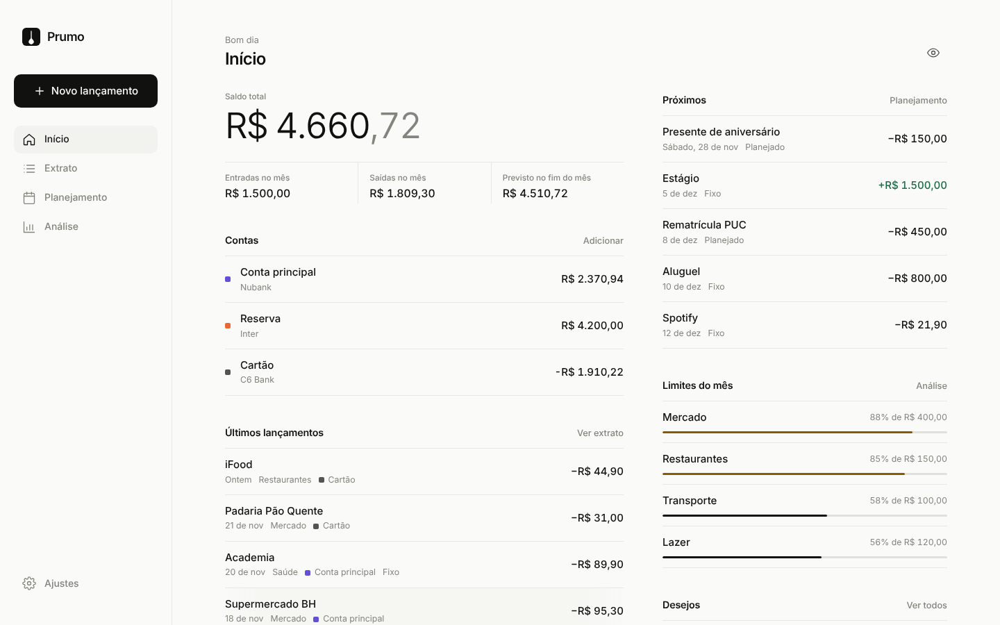
</p>

---

## O que é

O Prumo é um aplicativo de controle financeiro pessoal. Funciona no celular e no computador, direto no navegador, e pode ser instalado como um app comum.

Ele junta em um só lugar:

- o saldo de todas as suas contas e cartões;
- tudo o que você gasta, com onde, quanto, quantas vezes e por quê;
- os gastos fixos do mês, como aluguel e assinaturas;
- as compras que você planeja fazer;
- uma lista de desejos com quanto você já guardou para cada item.

Não tem cadastro, login ou propaganda, e nada é enviado para servidor nenhum. **Seus dados ficam só no seu aparelho.**

## Telas

<table>
  <tr>
    <td align="center">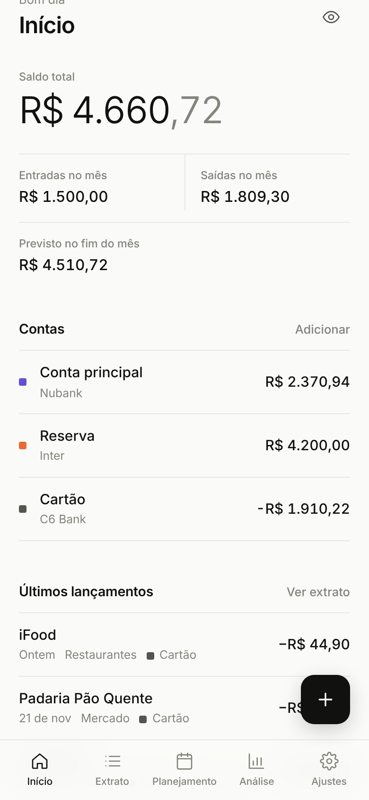<br /><sub>Início</sub></td>
    <td align="center">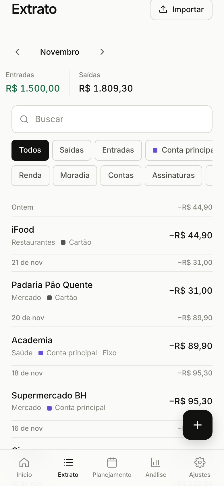<br /><sub>Extrato</sub></td>
    <td align="center">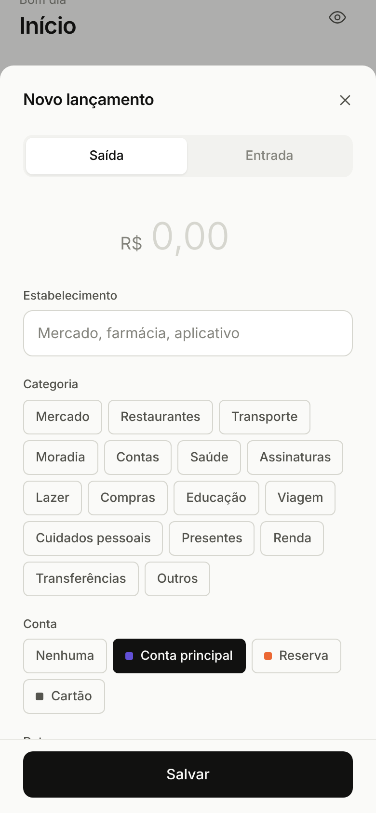<br /><sub>Novo lançamento</sub></td>
  </tr>
  <tr>
    <td align="center">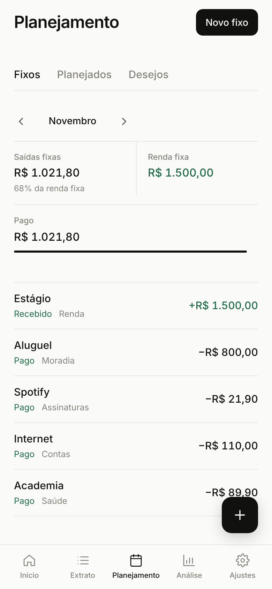<br /><sub>Gastos fixos</sub></td>
    <td align="center">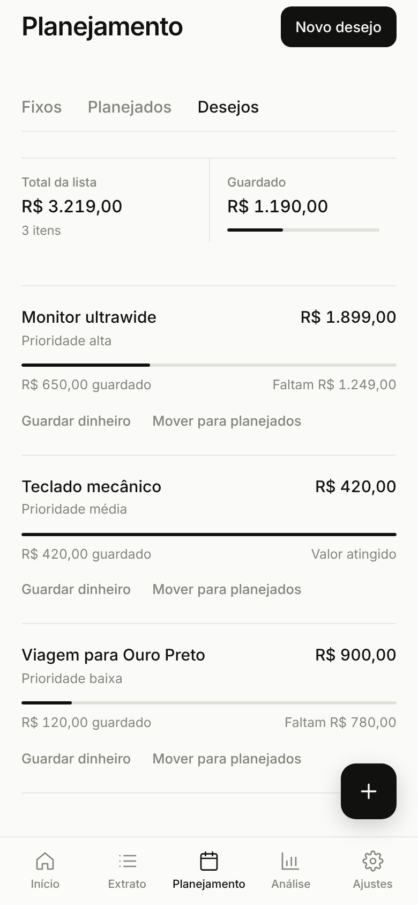<br /><sub>Lista de desejos</sub></td>
    <td align="center">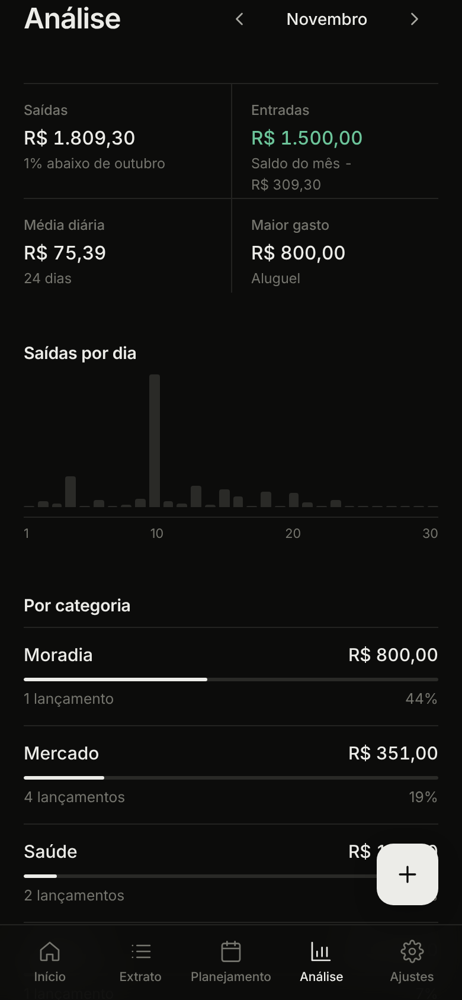<br /><sub>Análise, modo escuro</sub></td>
  </tr>
  <tr>
    <td align="center">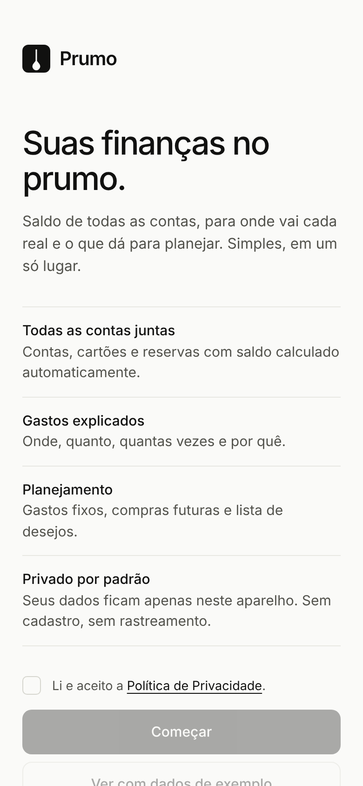<br /><sub>Boas-vindas</sub></td>
    <td align="center">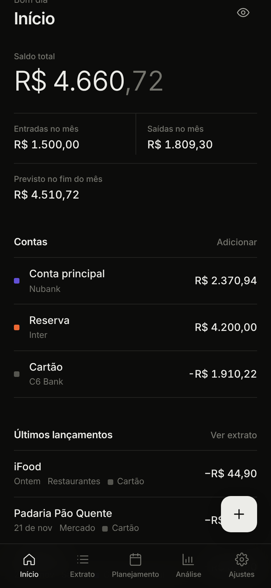<br /><sub>Início, modo escuro</sub></td>
    <td align="center">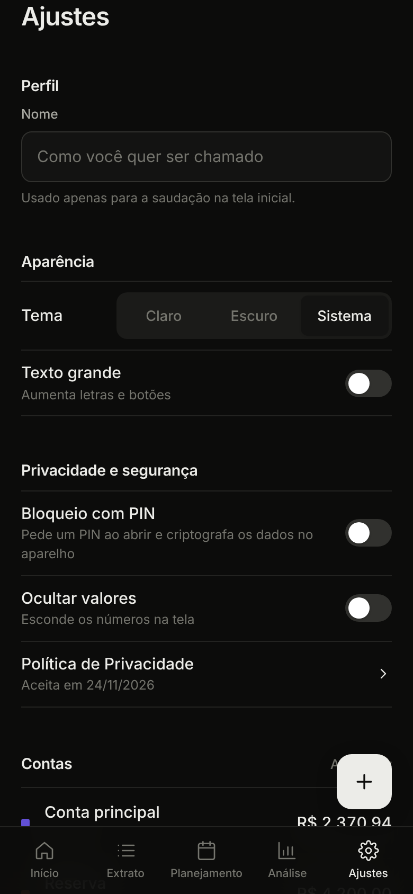<br /><sub>Ajustes</sub></td>
  </tr>
</table>

<p align="center">
  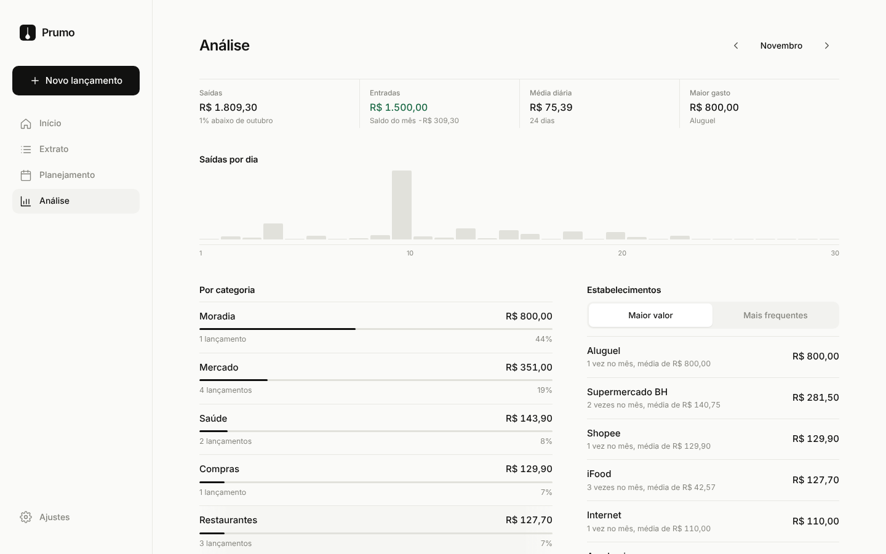
</p>

## Funcionalidades

### Início
- Saldo total somando todas as contas. Cartões de crédito entram como valor negativo.
- Entradas e saídas do mês.
- **Previsão de saldo no fim do mês**, considerando os gastos fixos que ainda vão vencer e os gastos planejados. Os gastos incertos aparecem como um cenário à parte.
- Próximos vencimentos, limites por categoria e progresso da lista de desejos.

### Extrato
- Todos os lançamentos do mês, agrupados por dia.
- Busca por estabelecimento, descrição ou observação.
- Filtros por tipo (entradas ou saídas), conta e categoria.
- Cada lançamento pode ter um **motivo**, para você lembrar por que gastou.

### Planejamento
- **Fixos**: aluguel, internet, assinaturas, salário. Você marca como pago ou recebido a cada mês e vê o que está atrasado e quanto da renda fixa está comprometido.
- **Planejados**: gastos futuros, marcados como confirmados ou incertos. Quando acontecem, viram lançamento com um toque.
- **Desejos**: o que você quer comprar, com prioridade e um cofrinho para cada item.

### Análise
- Saídas por dia, por categoria e por conta.
- **Estabelecimentos**: quanto você gastou em cada lugar, quantas vezes no mês e o valor médio.
- Comparação com o mês anterior e evolução dos últimos 6 meses.

### Importar extrato
O Prumo lê arquivos **OFX** e **CSV**, os formatos de exportação mais comuns dos bancos brasileiros. Os lançamentos são categorizados automaticamente, e o app aprende com as correções que você faz. Lançamentos já importados são ignorados.

### Acessibilidade
- Modo claro, escuro ou automático.
- Opção de texto grande.
- Navegação por teclado e suporte a leitores de tela.
- Respeita a preferência do sistema por menos animação.

## Como começar

1. Abra o Prumo no navegador.
2. Leia e aceite a Política de Privacidade.
3. Escolha **Começar** para usar com seus dados, ou **Ver com dados de exemplo** para conhecer o app primeiro.
4. Adicione suas contas e cartões, informando o saldo de hoje.
5. Registre seus gastos pelo botão **+** ou importe o extrato do seu banco em **Extrato > Importar**.
6. Cadastre seus gastos fixos em **Planejamento**.

### Como exportar o extrato do banco
Cada banco tem um caminho diferente, mas em geral fica no app ou no internet banking, em uma opção como *Extrato > Exportar* ou *Compartilhar extrato*. Escolha o formato **OFX** quando houver. Se só houver CSV, também funciona.

## Instalar como aplicativo

O Prumo é um PWA: depois de instalado, abre em tela cheia e funciona sem internet.

| Aparelho | Como instalar |
| --- | --- |
| **iPhone e iPad** (Safari) | Toque em **Compartilhar** e depois em **Adicionar à Tela de Início**. |
| **Android** (Chrome) | Toque no menu **⋮** e depois em **Instalar app** ou **Adicionar à tela inicial**. |
| **Computador** (Chrome ou Edge) | Clique no ícone de instalação na barra de endereço. |

## Privacidade e segurança

O Prumo foi pensado para seguir os princípios da **LGPD** (Lei nº 13.709/2018): coletar só o necessário, usar só para a finalidade informada e dar ao titular o controle total dos dados.

- **Sem servidor.** Os dados ficam no armazenamento local do navegador. O app não faz nenhuma requisição externa: sem analytics, sem rastreamento e sem fontes ou scripts de terceiros.
- **Consentimento registrado.** A Política de Privacidade é apresentada e aceita no primeiro uso, e a data do aceite aparece em Ajustes.
- **Bloqueio com PIN e criptografia.** Com o PIN ativo, os dados são criptografados no aparelho com AES-256-GCM, usando uma chave derivada do PIN com PBKDF2-SHA256 (310 mil iterações). A chave só existe na memória enquanto o app está aberto.
- **Bloqueio automático** depois de um tempo em segundo plano, configurável, e espera progressiva após tentativas erradas.
- **Ocultar valores** com um toque, para abrir o app em público.
- **Política de segurança de conteúdo (CSP)** que só permite recursos do próprio app.
- **Direitos do titular dentro do app:** exportar todos os dados (acesso e portabilidade), editar qualquer registro (correção) e excluir tudo de forma imediata (eliminação).

> **Importante:** se você esquecer o PIN, não há como recuperar os dados. Exporte seus dados de vez em quando e guarde o arquivo em local seguro, pois ele não é criptografado.
>
> Esta seção descreve o funcionamento técnico do app e não substitui orientação jurídica.

### Sobre conectar com os bancos automaticamente
A conexão direta com os bancos (Open Finance Brasil) exige um servidor e uma empresa intermediária autorizada pelo Banco Central, o que mudaria o modelo de privacidade do app. Por isso, hoje o Prumo funciona só com a importação de extrato. O modelo de dados já está preparado para receber essa integração no futuro.

---

## Para desenvolvedores

### Tecnologias
- [React 18](https://react.dev) e [Vite](https://vitejs.dev)
- CSS puro com design tokens, sem biblioteca de componentes
- Fonte Inter hospedada no próprio app
- Web Crypto API para a criptografia
- [Vitest](https://vitest.dev) para os testes

### Rodar localmente
Pré-requisito: [Node.js](https://nodejs.org) 18 ou mais recente.

```bash
git clone https://github.com/gabrielbaumgratz/baumfinances.git
```

```bash
cd baumfinances
```

```bash
npm install
```

```bash
npm run dev
```

O app abre em `http://localhost:5173`.

### Outros comandos

| Comando | O que faz |
| --- | --- |
| `npm test` | Roda os testes |
| `npm run build` | Gera a versão de produção em `dist/` |
| `npm run preview` | Serve a versão de produção localmente |

### Publicar no GitHub Pages
O build usa caminhos relativos, então funciona em qualquer hospedagem estática.

1. Rode `npm run build`.
2. Publique o conteúdo da pasta `dist/` (por exemplo, em um branch `gh-pages` ou com uma GitHub Action de Pages).
3. Em **Settings > Pages** do repositório, aponte para a origem escolhida.

O bloqueio com PIN precisa de HTTPS (ou `localhost`), porque a Web Crypto API só funciona em contexto seguro. O GitHub Pages já usa HTTPS.

### Estrutura

```
src/
  config.js        Nome, versão e contato do app
  styles.css       Design tokens e estilos
  lib/             Regras de negócio, sem interface
    selectors.js     Saldos, previsão, agrupamentos
    importers.js     Leitura de OFX e CSV
    categories.js    Categorias e categorização automática
    vault.js         Criptografia (AES-GCM + PBKDF2)
    store.jsx        Estado, persistência e bloqueio
  components/      Peças reutilizáveis de interface
  screens/         Telas
    forms/           Formulários em painel
tests/             Testes automatizados
scripts/           Geração de ícones e prints
docs/screenshots/  Imagens deste README
```

### Mudar o nome do app
O nome aparece a partir de `src/config.js`. Para trocar por completo, edite também `index.html`, `public/manifest.webmanifest` e os ícones em `public/`.
