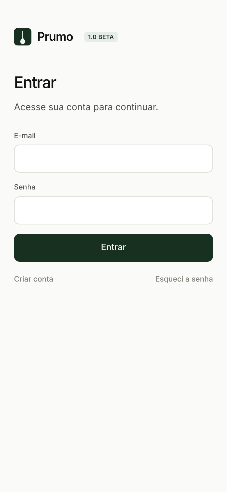
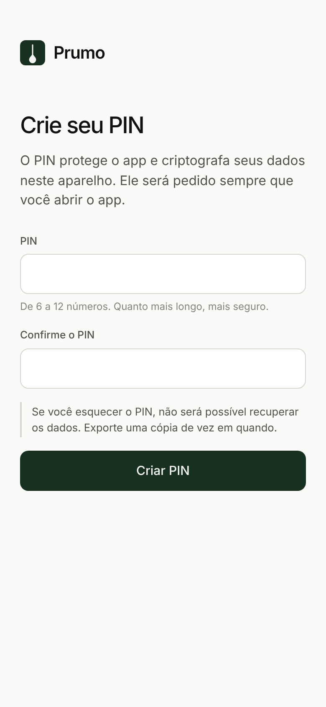

<p align="center">
  
</p>

<h1 align="center">Prumo</h1>

<p align="center">
  Finanças pessoais simples, bonitas e privadas.<br />
  Veja quanto você tem, para onde vai cada real e o que dá para planejar.<br />
  <sub>Versão 1.0 beta</sub>
</p>

<p align="center">
  
</p>

---

## O que é

O Prumo é um aplicativo de controle financeiro pessoal para celular e computador. Ele junta em um só lugar:

- o saldo de todas as suas contas e cartões;
- tudo o que você gasta, com onde, quanto, quantas vezes e por quê;
- os gastos fixos do mês, como aluguel e assinaturas;
- as compras que você planeja fazer;
- uma lista de desejos com quanto você já guardou para cada item.

**Seus dados financeiros ficam só no seu aparelho, criptografados.** A conta serve apenas para proteger o acesso.

## Telas

<table>
  <tr>
    <td align="center"><br /><sub>Início</sub></td>
    <td align="center"><br /><sub>Extrato</sub></td>
    <td align="center"><br /><sub>Novo lançamento</sub></td>
  </tr>
  <tr>
    <td align="center"><br /><sub>Gastos fixos</sub></td>
    <td align="center"><br /><sub>Lista de desejos</sub></td>
    <td align="center"><br /><sub>Análise, modo escuro</sub></td>
  </tr>
  <tr>
    <td align="center"><br /><sub>Instalação obrigatória</sub></td>
    <td align="center"><br /><sub>Login</sub></td>
    <td align="center"><br /><sub>PIN obrigatório</sub></td>
  </tr>
</table>

<p align="center">
  
</p>

## Funcionalidades

### Início
- Saldo total somando todas as contas. Cartões de crédito entram como valor negativo.
- Entradas e saídas do mês.
- **Previsão de saldo no fim do mês**, considerando os gastos fixos que ainda vão vencer e os gastos planejados. Os gastos incertos aparecem como um cenário à parte.
- Próximos vencimentos, limites por categoria e progresso da lista de desejos.

### Extrato
- Lançamentos do mês agrupados por dia, com busca e filtros por tipo, conta e categoria.
- Cada lançamento pode ter um **motivo**, para você lembrar por que gastou.

### Planejamento
- **Fixos**: aluguel, internet, assinaturas, salário. Marque como pago ou recebido a cada mês e veja o que está atrasado.
- **Planejados**: gastos futuros, confirmados ou incertos. Quando acontecem, viram lançamento com um toque.
- **Desejos**: o que você quer comprar, com prioridade e um cofrinho para cada item.

### Análise
- Saídas por dia, por categoria e por conta.
- **Estabelecimentos**: quanto você gastou em cada lugar, quantas vezes no mês e o valor médio.
- Comparação com o mês anterior e evolução dos últimos 6 meses.

### Importar extrato
Lê arquivos **OFX** e **CSV**, os formatos mais comuns dos bancos brasileiros. Categoriza automaticamente, aprende com suas correções e ignora lançamentos repetidos.

### Acessibilidade
Modo claro, escuro ou automático, texto grande, navegação por teclado e suporte a leitores de tela.

## Instalar

Por segurança, **o Prumo só funciona instalado**. Aberto numa aba comum do navegador, ele mostra as instruções de instalação.

| Aparelho | Como instalar |
| --- | --- |
| **iPhone e iPad** | Abra o endereço do app no **Safari**, toque em **Compartilhar** e em **Adicionar à Tela de Início**. |
| **Android** | Abra no **Chrome**, toque no menu **⋮** e em **Instalar app**. Ou baixe o APK na página de [Releases](../../releases). |
| **Computador** | Abra no **Chrome** ou **Edge** e clique no ícone de instalação na barra de endereço. |

### Primeiro acesso
1. Crie sua conta com e-mail e senha e aceite a Política de Privacidade.
2. Confirme o e-mail pelo link que chegar na sua caixa de entrada.
3. Entre e ative a **verificação em 2 etapas** com um app autenticador (Google Authenticator, Microsoft Authenticator ou o app Senhas do iPhone).
4. Escolha começar do zero ou com dados de exemplo.
5. Crie seu **PIN** de 6 a 12 números.

### Atualizações
Quando uma nova versão é publicada, o app instalado baixa a atualização sozinho e mostra o botão **Atualizar**.

## Privacidade e segurança

O Prumo segue os princípios da **LGPD** (Lei nº 13.709/2018): coleta só o necessário, usa só para a finalidade informada e dá ao titular controle total dos dados.

**Acesso em camadas**
- **App instalado:** não funciona numa aba comum do navegador.
- **Conta:** e-mail confirmado, senha de no mínimo 10 caracteres e **verificação em 2 etapas obrigatória**.
- **PIN obrigatório:** sem ele, nenhum dado é gravado. Depois de 5 erros, o app espera 30 segundos, e o tempo aumenta a cada nova sequência. A espera continua mesmo se a página for recarregada.
- **Bloqueio automático** ao sair do app, com tempo configurável.

**Dados**
- **Criptografia no aparelho:** AES-256-GCM, com chave derivada do PIN por PBKDF2-SHA256 com 600 mil iterações, como recomenda a OWASP. A chave só existe na memória enquanto o app está desbloqueado.
- **Separação por conta:** cada conta tem seu próprio cofre no aparelho.
- **Sem servidor para dados financeiros.** O servidor de contas guarda apenas e-mail, senha protegida e o 2FA.
- **Sem cookies, anúncios, analytics ou recursos de terceiros.**
- **Exportação criptografada** com senha.

**Tela**
- **Android (app nativo):** capturas de tela bloqueadas, e os dados ficam fora do backup em nuvem e da transferência entre aparelhos.
- **iPhone (app nativo):** o conteúdo fica coberto na tela de apps recentes.
- **Versão instalada pelo navegador:** a tela é coberta quando o app sai de foco. Navegadores não permitem bloquear capturas de tela, então essa proteção só existe nos apps nativos.

**Código**
- Política de segurança de conteúdo (CSP) que bloqueia scripts e conexões não autorizados.
- O app se recusa a abrir dentro de outro site (proteção contra clickjacking).
- Código publicado minificado, sem mapas de código-fonte e sem mensagens de depuração.
- Nenhum segredo no código: a chave pública do Supabase é feita para ficar no app.
- Dependências sem vulnerabilidades conhecidas (`npm audit`).

**Direitos do titular dentro do app:** exportar dados (acesso e portabilidade), editar qualquer registro (correção), excluir dados do aparelho e excluir a conta no servidor (eliminação).

> Se você esquecer o PIN, não há como recuperar os dados. Exporte uma cópia criptografada de vez em quando.
>
> Esta seção descreve o funcionamento técnico do app e não substitui orientação jurídica.

### Sobre conectar com os bancos automaticamente
A conexão direta com os bancos (Open Finance Brasil) exige uma empresa intermediária autorizada pelo Banco Central e mudaria o modelo de privacidade do app. Por enquanto, o Prumo funciona com a importação de extrato.

---

## Para quem publica o app

### 1. Criar o servidor de contas (Supabase)
1. Crie uma conta gratuita em [supabase.com](https://supabase.com) e um novo projeto. Escolha a região mais próxima dos usuários.
2. Em **SQL Editor**, rode o conteúdo de [`supabase/setup.sql`](supabase/setup.sql). Ele cria a função que permite ao usuário excluir a própria conta.
3. Em **Authentication > Providers > Email**, deixe **Confirm email** ativado e defina o tamanho mínimo de senha como 10.
4. Em **Authentication > Multi-Factor**, ative o **TOTP (App Authenticator)**.
5. Em **Authentication > URL Configuration**, coloque o endereço publicado do app em **Site URL** e em **Redirect URLs**.
6. Configure um **SMTP próprio** em **Authentication > Emails**. O envio de e-mail embutido do Supabase tem limite baixo por hora e serve só para testes.
7. Em **Project Settings > API**, copie a **Project URL** e a chave **anon public**. Nunca use a chave `service_role` no app.

> As opções e os limites do Supabase podem mudar. Confira os planos e a documentação deles antes de abrir o app para mais pessoas.

### 2. Publicar a versão web (GitHub Pages)
1. No repositório, vá em **Settings > Secrets and variables > Actions** e crie os secrets `VITE_SUPABASE_URL` e `VITE_SUPABASE_ANON_KEY`. Crie também a variável `VITE_APP_URL` com o endereço do app, por exemplo `https://gabrielbaumgratz.github.io/Baumfinances/`.
2. Em **Settings > Pages**, em **Source**, escolha **GitHub Actions**.
3. A cada push na `main`, o workflow [`pages.yml`](.github/workflows/pages.yml) roda os testes, gera o app e publica. Quem já instalou recebe a atualização automaticamente.

Sem os secrets do Supabase, o app funciona sem login (só com o PIN), o que é útil para testes.

### 3. APK para Android
O workflow [`android.yml`](.github/workflows/android.yml) compila o APK a cada push e o deixa em **Actions > execução > Artifacts**. Ao criar uma tag `v*`, o APK vai para um Release.

Para um APK assinado (e o `.aab` para lojas), crie uma keystore uma única vez:

```bash
keytool -genkeypair -v -keystore prumo.jks -alias prumo -keyalg RSA -keysize 2048 -validity 10000
```

Depois cadastre os secrets `PRUMO_KEYSTORE_BASE64` (o arquivo em base64, gerado com `base64 -w0 prumo.jks`), `PRUMO_KEYSTORE_PASSWORD`, `PRUMO_KEY_ALIAS` e `PRUMO_KEY_PASSWORD`. Guarde a keystore em local seguro: sem ela não é possível publicar atualizações.

### 4. iPhone (app nativo)
Precisa de um Mac com Xcode e de uma conta no Apple Developer Program. No Brasil, a partir do iOS 26.5, também é possível distribuir por lojas alternativas autorizadas pela Apple, depois da notarização. Os passos estão na [documentação da Apple](https://developer.apple.com/support/app-distribution-in-brazil/).

```bash
npm run ios
```

---

## Para desenvolvedores

### Tecnologias
React 18, Vite, CSS puro com design tokens, fonte Inter hospedada no app, Web Crypto API, Supabase Auth, Capacitor (Android e iOS) e Vitest.

### Rodar localmente
Pré-requisito: [Node.js](https://nodejs.org) 20 ou mais recente.

```bash
git clone https://github.com/gabrielbaumgratz/baumfinances.git
```

```bash
cd baumfinances
```

```bash
npm install
```

```bash
npm run dev
```

Em modo de desenvolvimento, o app abre no navegador sem precisar instalar. Para testar o login, copie `.env.example` para `.env.local` e preencha com os dados do seu projeto Supabase.

| Comando | O que faz |
| --- | --- |
| `npm test` | Roda os testes |
| `npm run build` | Gera a versão de produção em `dist/` |
| `npm run preview` | Serve a versão de produção localmente |
| `npm run android` | Gera o web, sincroniza e abre no Android Studio |
| `npm run android:apk` | Compila um APK de debug (precisa do Android SDK) |
| `npm run ios` | Gera o web, sincroniza e abre no Xcode |

### Estrutura

```
src/
  config.js        Nome, versão, regras do PIN e configuração do login
  Root.jsx         Camadas de acesso: instalação, conta e PIN
  styles.css       Design tokens e estilos
  lib/             Regras de negócio, sem interface
    store.jsx        Estado, cofre criptografado e bloqueio
    vault.js         Criptografia (AES-GCM + PBKDF2)
    auth.js          Cliente do Supabase e mensagens de erro
    pwa.js           Instalação e atualização automática
    selectors.js     Saldos, previsão, agrupamentos
    importers.js     Leitura de OFX e CSV
  components/      Peças reutilizáveis de interface
  screens/         Telas
    auth/            Login, cadastro e 2FA
    forms/           Formulários em painel
public/sw.js       Service worker com versão por build
supabase/          SQL do servidor de contas
tests/             Testes automatizados
android/ ios/      Projetos nativos
```

### Mudar o nome do app
O nome vem de `src/config.js`. Para trocar por completo, edite também `index.html`, `public/manifest.webmanifest`, `capacitor.config.json` e os ícones em `public/` e `assets/`.
